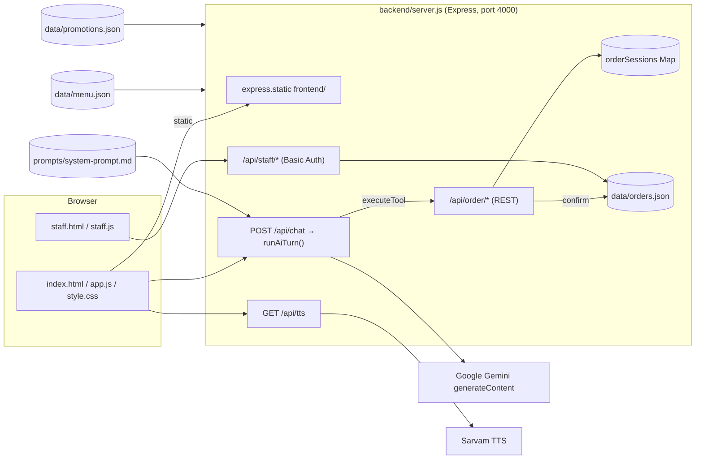

# 02 — Technical Architecture

## Stack (Verified)
| Layer | Technology |
|---|---|
| Runtime | Node.js `>=18` (`backend/package.json` engines; developed on Node v24.15.0). Uses global `fetch`. |
| Server | Express `^4.19.2`, dotenv `^16.4.5` (only two dependencies; lockfile `backend/package-lock.json`) |
| Frontend | Plain HTML/CSS/JS, **no framework, no bundler, no build step**. Figtree font from Google Fonts (chat window only) |
| AI chat | Google Gemini native `generateContent` REST API (`https://generativelanguage.googleapis.com/v1beta/models/{LIVE_MODEL}:generateContent`), tool-calling via `functionDeclarations` |
| TTS | Sarvam AI Bulbul streaming (`https://api.sarvam.ai/text-to-speech/stream`), MP3 piped to the browser |
| STT | Browser Web Speech API (`SpeechRecognition`/`webkitSpeechRecognition`, `lang = "en-IN"`) |
| Persistence | `data/orders.json` flat file + in-memory `Map` (no DB) |
| Hosting (historical) | Render web service (`smart-order-bot.onrender.com`) — Recovered; current state Unknown |

## System diagram


## Directory structure & responsibilities
```
.env / .env.example     config (root; .env gitignored)          CLAUDE.md  project rules
backend/server.js       whole backend (2,221 lines)              backend/package.json
data/menu.json          70 items (source of truth)               data/promotions.json  3 promos (2 active)
data/orders.json        runtime order log (gitignored, PII)
prompts/system-prompt.md  RoboCap behavior (245 lines)
frontend/index.html     all customer views (342 lines)           frontend/app.js   (2,711 lines)
frontend/style.css      (3,107 lines)                            frontend/staff.{html,js,css}
frontend/assets/        menu/*.jpg (70), petpooja-logo.png, petpooja-logo-white.svg
.claude/launch.json     dev-preview config (static python server on :8123 — NOT API-capable)
.claude-flow/           tooling session noise (52 files tracked in git) — ignore
```
See `10_FILE_AND_COMPONENT_INDEX.md`.

## Backend internals (`backend/server.js`, Verified)
- **Startup:** loads `.env` from the project root, reads `prompts/system-prompt.md`, `menu.json`, `promotions.json` once (restart required after editing them). Warns (does not crash) if `GOOGLE_API_KEY`, `SARVAM_API_KEY`, or `STAFF_*` are missing.
- **Config constants:** `TAX_RATE = 0.08`, `DELIVERY_FEE = 40`, `SARVAM_TTS_MAX_CHARS = 3500`, `MAX_TOOL_CALL_STEPS = 6`.
- **Middleware:** `express.json()`, hand-written permissive CORS (`*`, methods GET/POST/PATCH/DELETE/OPTIONS), JSON-parse-error handler, `express.static(frontend)`.
- **Session/order state:** `orderSessions` `Map<sessionId, order>`; `createEmptyOrder()` defines the shape (items, orderType, customer, pickupTime, deliveryAddress{address,apartmentUnit,instructions,confirmed}, promotionId, notes, subtotal, discount, tax, deliveryFee, total, confirmed, status, orderId).
- **AI loop (`runAiTurn`):** builds `contents` from frontend history → system instruction = cached static part (`buildSystemContent()`: system prompt + full menu JSON + active promotions + totals rules) + live "Current Order State" with an exact pre-computed cart line → `callAiApi` → executes each `functionCall` via `executeTool` → feeds results back as a `user` turn of `functionResponse` parts (Gemini rejects a `function` role) → repeats up to 6 steps. Latest tool result carrying `quickReplies` wins; flags `isComparison`, `isOrderSummary`, `isPairingSuggestion`, `orderJustConfirmed` travel with it.
- **Tools (24):** `search_menu_items, add_item_to_order, update_order_item, remove_order_item, apply_promotion, present_fulfillment_options, set_pickup_details, set_delivery_details, confirm_delivery_address, set_dine_in_details, set_order_notes, get_order_review, get_recommendations, get_bestsellers, get_chefs_recommendations, get_spicy_items, get_vegetarian_items, get_non_vegetarian_items, present_quantity_options, present_notes_options, compare_items, get_eligible_promotions, present_confirmation_options, confirm_order`. Defined in `TOOL_DEFINITIONS` (+ derived `GEMINI_FUNCTION_DECLARATIONS`), dispatched in `executeTool` (lines ~496–600). They add no new business logic — they wrap the same functions the REST routes use.
- **Pricing:** `recalculateTotal()` is the *only* place `order.total` is set. Any edit after confirmation un-confirms the order.
- **Auth:** `requireStaffAuth` — HTTP Basic, constant-time compare via SHA-256 digests, fails closed with 503 if credentials unset.

## API surface (Verified; routes at `backend/server.js` lines 1722–2210)
| Method & path | Purpose |
|---|---|
| `POST /api/chat` | `{message, history[], sessionId}` → AI reply + quickReplies + flags + `order` |
| `GET /api/tts?text=` | Streams MP3 from Sarvam (text in query string, truncated to 3500 chars) |
| `GET /api/menu` | Full menu |
| `GET /api/menu/recommendations` | Up to 5 recs for the session order (route text says 1–2 in older docs; code slices 5) |
| `POST /api/order/items` · `PATCH/DELETE /api/order/items/:lineId` | Add / modify / remove-or-reduce |
| `GET /api/order/summary` · `GET /api/order/review` | Text summary / structured pre-checkout review (incl. `readyForCheckout.blockers`) |
| `GET /api/promotions/eligible` · `POST /api/order/promotion` | Eligible promos / apply one (explicit — never auto-applied) |
| `POST /api/order/pickup` · `/dine-in` · `/delivery` · `/delivery/confirm-address` · `/notes` | Fulfillment + notes |
| `GET /api/order/history` | This session's confirmed orders, newest first |
| `POST /api/order/confirm` | Explicit-confirmation gate → saves to `data/orders.json`, then resets cart |
| `GET /api/staff/orders` · `PATCH /api/staff/orders/:orderId` | Staff (Basic Auth); statuses: confirmed, preparing, ready, completed, cancelled |

## Frontend architecture (Verified)
- `index.html` contains every view: header (`#mainHeader`) + tab bar (`Menu`, `Orders` only) + `#tab-menu` (RoboCap banner + `#menuCategoriesContainer`), `#tab-orders`, pushed views `#view-cart`, `#view-checkout`, and the **chat overlay `#view-chat`** (splash, chat area, item customization sheet `#itemSheetBackdrop`, order-locked banner, composer form).
- `app.js` sections: icons/consts → TTS → message/reply-chip rendering (`REPLY_CHIP_RULES` maps text patterns to icon+flavor) → item cards, cart summary card → item customization sheet → `sendChatMessage` → speech-to-text → API helpers (`apiGet/apiSend`, `state`) → tabs/views (`showTab`, `showView`, chat open/close animation via `--chat-origin-x/y`) → Menu → Cart → Checkout → Orders.
- Client state: `state` object, `chatHistory[]` (sent to AI each turn), `sessionStorage.cafebotSessionId`, `localStorage.robocapMuted`; staff creds in `sessionStorage.cafebotStaffAuth`.
- Theming: `:root` = light/blue; `#view-chat { --accent:#f36a20; --accent-gradient:…; … }` = dark/orange. Shared `--accent-gradient` (diagonal `color-mix` of `--accent`) fills all primary CTA buttons.
- Chat ambient background: `#view-chat::before` — four corner color gradients used as a **`mask-image` source** clipped to a 5px dot grid (`mask-size:5px`, dot radius 1.5px) on flat black, plus a slow `hue-rotate` "breathing" animation.

## Build/runtime/test/deploy
- No build, lint, type-check, or test tooling. Runtime = `node server.js`. Deploy target (historical) = single Render web service with `PORT` from the host. Details: `07_DEVELOPMENT_AND_OPERATIONS.md`.

## Known technical debt & risks
- 2,200–3,100-line single files (violates the "files under 500 lines" and "small files" guidance in the CLAUDE.md files).
- No tests; verification has been manual (browser + curl).
- Gemini API key is sent as a **URL query parameter** (`?key=`); server-side only, but would appear in any outbound-request logging.
- `GET /api/tts?text=` puts reply text in URLs (proxy/access logs).
- No rate limiting, no CSRF considerations (no cookies used), CORS `*`.
- `/api/order/history` is unauthenticated and keyed only by a guessable-in-principle `sessionId` (UUID, so low risk).
- Stale code comment in `server.js` ("frontend is served from a different port") and README ("four tabs").
- Stale env vars in local `.env`: `AI_API_BASE_URL`, `AI_API_KEY`, `AI_MODEL`, `LIVE_VOICE` are unused by the current code.
